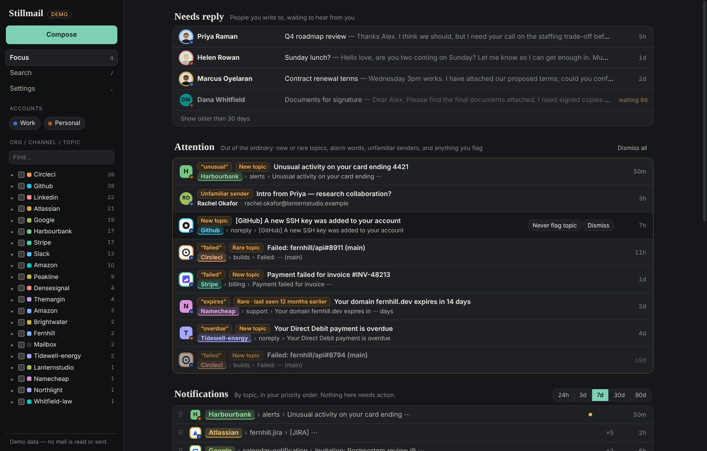

# Stillmail

A calm desktop Gmail client. The default is to do nothing: there is no unread count and nothing to clear. People you correspond with come first, notification mail is grouped by topic, and only out-of-the-ordinary mail asks for attention.



## Try it

```bash
npm install
```

```bash
npm run demo
```

`npm run demo` opens the app on a fictional two-account mailbox, so you can try everything without connecting Gmail. `npm start` runs it for real.

## Connecting Gmail

Stillmail talks to Gmail directly from your machine with your own Google OAuth client. No server sits in between.

1. In [Google Cloud Console](https://console.cloud.google.com/), create a project and enable the **Gmail API**.
2. Also enable the **People API** (used only for contact photos). Configure the OAuth consent screen. Add the scopes `gmail.readonly`, `gmail.send`, `contacts.readonly` and `contacts.other.readonly`, and add each of your Gmail addresses as a test user (for a Workspace account you can choose *Internal* instead).
3. Create credentials → **OAuth client ID** → application type **Desktop app**.
4. Start Stillmail, paste the client ID and secret, then **Connect a Gmail account** once per account. Each account gets a tag (Work, Personal, …) you can rename and recolour in Settings.

While the consent screen is in *Testing*, Google expires sign-ins after 7 days. Publishing the app (it can stay unverified for personal use) removes that limit.

Stillmail requests read-only access to mail and contacts, plus permission to send. It never archives, labels, marks as read or deletes anything in Gmail. All of its own state (who is important, topic order, dismissals) is stored locally.

## How it works

**Needs reply.** Any address you have ever written to is an important sender. Automatic replies (such as a vacation responder) do not count, and a mass sender (list headers or a no-reply style address) only counts once you have written to it at least twice and at least once for every ten emails it has sent. A conversation appears here when the latest message is from one of them and you have not answered since. Replying removes it; so does *No reply needed*.

**Notification channels.** An address that has sent you several emails (3 by default) and never had a reply is a notification channel. So is anything with bulk-mail headers or a no-reply style address. You can override any address in the reader or in Settings.

**Topics.** Within a channel, subjects are reduced to a pattern (ids, dates and amounts are collapsed) and grouped, so `Your order #123 has shipped` and `Your order #456 has shipped` are one topic. Shared `[tags]`, single varying words, and common prefixes are also grouped. A sender whose subject changes with every issue, such as a newsletter, is treated as a single topic named after the address alone; this is detected automatically, and *One topic for this sender* forces it for any address. When that is not enough, *Define topic by pattern…* lets you group with a regular expression. Topics are shown as `Org › channel › topic` with the time of the latest email, over the period chosen at the top of the panel. Drag the handle (or Alt+↑/↓) to pin topics in priority order; unpinned topics follow by recency.

**Attention.** A notification email is escalated when:

- its topic is new or rare for an established channel, or returns after 90+ days,
- its subject or preview contains an alarm word (overdue, expired, revoked, failed, suspended, unusual activity, … editable in Settings),
- it comes from an unfamiliar sender that is neither important nor a channel,
- or you flag it yourself.

Dismiss an item, or choose *Never flag topic* if a topic is always noise. Channels that send a different subject every time (newsletters, marketing) are not flagged for novelty.

**Faces and colours.** People are circles and organisations are rounded squares. A person shows their contact photo when your Google contacts have one, otherwise their initials. A notification channel shows its organisation's site icon at full size with no backing tile, otherwise its initial on a coloured square. The organisation's name is underlined in its brand colour, picked automatically as the dominant colour of the icon that is not near white, near black or grey; a monochrome logo gets a white underline (and a dark logo on a transparent background is inverted so it shows on the dark theme). An organisation with no icon gets a colour assigned from a fixed palette, which never changes. People at a company share its colour, while people on public mailboxes (gmail.com and similar) each get their own. Icons are fetched from Google's favicon service and cached; photos and icons can be turned off in Settings.

**Bump.** Any item in Needs reply or Attention can be bumped (row button, reader button, or `b`). It jumps to the top, and its bump date replaces its received date for ordering and fading, so it stays on the list while untouched items slip away. Bump again to keep it there. The age shown is still the real one, with an ↑ marker.

**Time tabs.** Needs reply, Attention and Notifications each have their own 24h / 3d / 7d / 30d / 90d tabs, remembered separately. Needs reply and Attention use the bump date where there is one, and anything you flagged yourself stays in Attention whatever the tab. Needs reply keeps a *Show older* link so nobody is lost.

**Links.** Clicking a link in an email opens the page in a browser pane to the right of the message, with back, forward, reload and *Open in default browser*. ⌘-click (Ctrl-click on Windows and Linux) sends a link straight to your default browser instead. The pane is an isolated web page with its own cookies; it has no access to your mail and no camera, microphone, location or notification permissions. `mailto:` links start a new message.

**Fading.** Mail is at full strength for 7 days, dimmed until 30 days, then leaves the home view and lives on in Search. Both cutoffs are settings.

**Filters.** Account tags and the org / channel / topic tree in the sidebar are multi-select and filter every view.

**Search.** Narrow by sender first: pick one or more domains, then exact addresses, then type text. Counts update as you go. Quick search covers subjects and previews of synced mail instantly; press Enter to run the same query against full message text on Gmail.

**Desktop notifications** fire only for important senders and escalated mail.

## Keyboard

| Key | Action |
| --- | --- |
| `c` | Compose |
| `/` | Search |
| `g` | Focus (home) |
| `,` | Settings |
| `r` / `a` / `f` | Reply / reply all / forward the open conversation |
| `b` | Bump the open conversation to the top of its list |
| `e` | Dismiss or mark no reply needed, and close |
| `Esc` | Close reader or dialog |
| `Ctrl/⌘ + Enter` | Send |

## Development

```bash
npm test
```

```bash
npm run e2e
```

`npm test` runs unit tests for classification, MIME building and sync. `npm run e2e` drives the real Electron app in demo mode and needs [Playwright](https://playwright.dev/) installed (`npm i -D playwright`); on a headless Linux box wrap it in `xvfb-run -a`.

```
src/core      pure logic: sender classification, topic clustering, attention rules, MIME
src/main      Electron main process: OAuth, Gmail REST client, sync, persistence, IPC
src/renderer  UI (Preact + htm, no build step) and the demo mailbox
```

`npm run dist` packages an installer with electron-builder.

## Known limits

- The first sync fetches metadata for 12 months of received mail (configurable) and all sent mail; it runs at about 30 messages a second to stay inside Gmail's per-minute quota, so a large mailbox takes a while (roughly half an hour for 50,000 messages). The app is usable while it runs.
- Composing is plain text. Drafts are not saved to Gmail.
- Notifications need the app to be running; closing the window quits it on Windows and Linux.
- Organisation names come from the sender's registrable domain, using a built-in list of common two-level suffixes rather than the full Public Suffix List.
